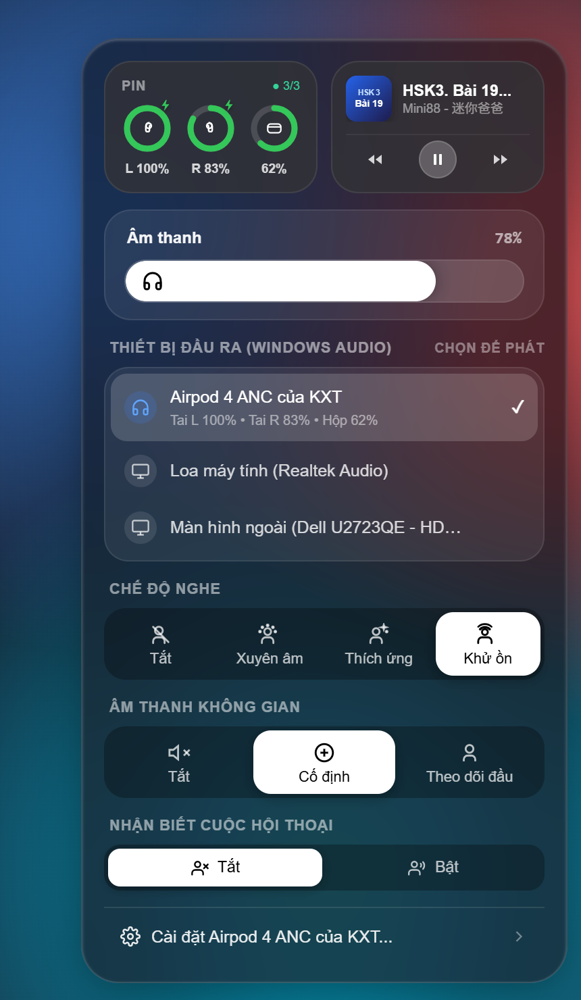
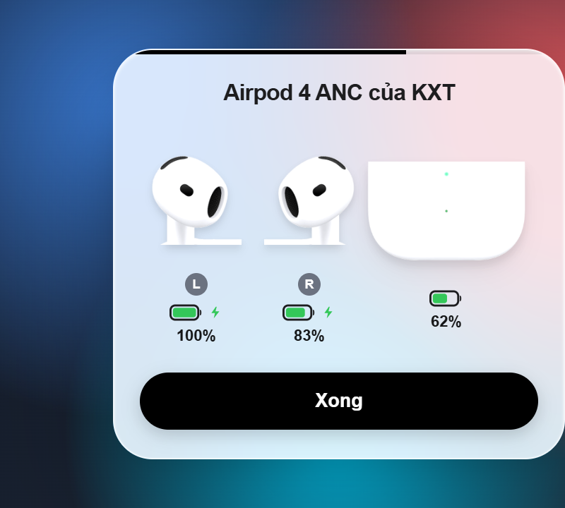
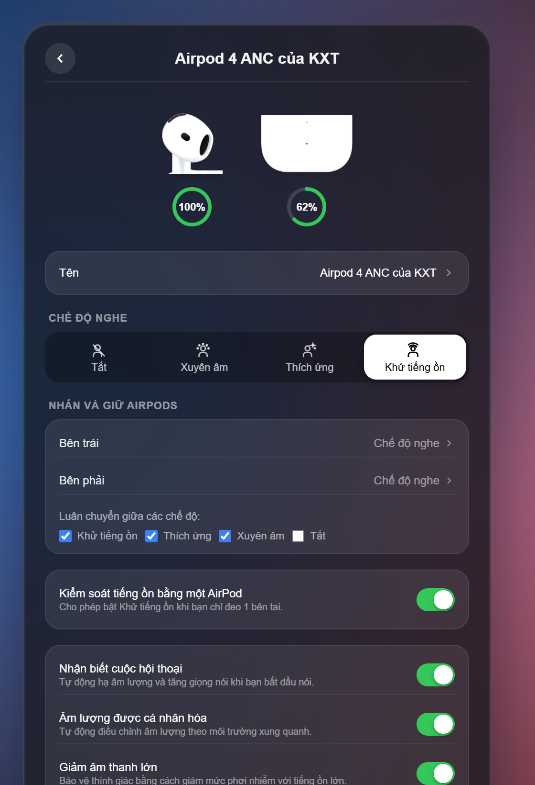

# 🪷 LotusAir — Trình Điều Khiển Apple AirPods (AirPods 4 ANC) Cho Windows 11

> Ứng dụng desktop siêu nhẹ viết bằng **Rust + Tauri v2 + TypeScript/Tailwind** kết hợp **WDM Kernel Driver (`LotusAirDriver.sys`)** và **Windows CoreAudio / BthA2dp API**, mang trải nghiệm điều khiển AirPods chuẩn macOS Sequoia lên Windows 11 — **chỉ tốn ~4.5 MB RAM khi chạy nền**.

## 🖼️ Giao Diện Ứng Dụng

<table>
  <tr>
    <td align="center" width="33%">
      <br />
      <b>Control Center Flyout</b><br />
      <sub>Pin 3 vòng tròn, Media, Âm lượng, Đầu ra Windows & Chế độ nghe</sub>
    </td>
    <td align="center" width="33%">
      <br />
      <b>Popup Mở Nắp Hộp (BLE 0x07)</b><br />
      <sub>Tự hiện góc phải sát Taskbar khi mở nắp hộp / rút tai nghe</sub>
    </td>
    <td align="center" width="33%">
      <br />
      <b>Cài Đặt AirPods 4 Đầy Đủ</b><br />
      <sub>Đồng bộ thời gian thực, hỗ trợ đầy đủ tính năng chip H2</sub>
    </td>
  </tr>
</table>

---

## ✅ Những Gì Đã Hoàn Thành & Kiểm Thử Thực Tế (Trên AirPods 4 ANC)

### 1. Giao thức Apple AAP / AACP chuẩn chip H2 qua L2CAP PSM `0x1001`
- **Kernel Driver tự biên dịch (`driver/LotusAirDriver.sys`)**: Viết bằng WDM C thuần (`driver/src/driver.c`), giao tiếp trực tiếp với `bthport.sys` / `bthenum.sys` qua `IRP_MJ_INTERNAL_DEVICE_CONTROL` (`IOCTL_INTERNAL_BTH_SUBMIT_BRB = 0x00410003`) đúng layout 64-bit Windows 11 build 26100 (`BRB_L2CA_OPEN_CHANNEL = 0x0102`, `BRB_L2CA_ACL_TRANSFER = 0x0105`, `BRB_L2CA_CLOSE_CHANNEL = 0x0104`).
- **Bộ gói tin AAP/AACP chuẩn Apple** (`crates/lotusair-core/src/aap/`):
  - Bắt tay **Handshake Init** 16 bytes (`00 00 04 00 01 00 02 00 ...`) & **SET_SPECIFIC_FEATURES** 14 bytes (`04 00 04 00 4D 00 D7 00 ...`) mở khóa tính năng chip H2.
  - **Chuyển chế độ chống ồn thực tế trên tai nghe**: Khử tiếng ồn (**ANC**), **Xuyên âm (Transparency)**, **Âm thanh thích ứng (Adaptive)** kèm thanh kéo mức thích ứng (`0..100%`), và **Tắt (Off)** (tự động gửi kèm `AllowOffOption` `0x34`).
  - **Điều khiển tính năng nâng cao**: Nhận biết cuộc hội thoại (`0x28`), Âm lượng cá nhân hóa (`0x26`), Giảm âm thanh lớn (`0x37`), One-Bud ANC (`0x1B`), Tự động phát hiện tai (`0x0A`), Cử chỉ đầu (`0x24`), Luân chuyển chế độ khi nhấn giữ thân tai (`0x1A`), Âm thanh & âm lượng hộp sạc (`0x31` / `0x1F`), Đổi tên AirPods (`0x1E`).
  - **Nhận diện bền vững theo Apple AAP Server UUID**: Tự động nhận diện AirPods qua `{74EC2172-0BAD-4D01-8F77-997B2BE0722A}` trong Registry (không bị lỗi `device not found` khi đổi tên tai nghe) và tự động kết nối lại L2CAP + Handshake nếu kênh bị ngắt tạm thời.

### 2. Cướp kết nối AirPods từ iPhone/iPad sang Laptop (Cướp chủ động thông minh)
- **Cướp chủ động khi chọn đầu ra AirPods trên Windows**: Khi bạn chọn đầu ra âm thanh là AirPods (dù bấm trong danh sách **Thiết bị đầu ra** của LotusAir hay chọn trực tiếp từ Windows Sound / Taskbar), LotusAir gửi **đúng 1 nhịp `KSPROPERTY_ONESHOT_RECONNECT`** (`KSPROPSETID_BtAudio`) xuống `BthA2dp.sys`, tạm dừng kênh L2CAP trong lúc kéo để tránh xung đột băng thông Bluetooth/giật tiếng, và tự định tuyến lại luồng WASAPI Stereo **Headphones** ngay khi Windows kích hoạt endpoint.
- **Tôn trọng logic tự nhiên của Apple khi không chọn AirPods**: Khi laptop đang phát qua loa máy tính / HDMI và bạn không chọn AirPods, LotusAir không tranh chấp kết nối mà để AirPods chuyển đổi tự nhiên giữa iPhone/iPad theo cơ chế gốc của Apple.
- Hỗ trợ cướp nhanh 1 chạm ngay cả khi AirPods đang nối iPhone từ hàng trên cùng của **Control Flyout** hoặc **System Tray Menu** (`Cướp AirPods từ iPhone -> PC`).

### 3. Đọc Pin thực tế, Popup Mở Nắp Hộp (BLE Thời Gian Thực) & Media Windows
- **Bật Popup tức thì khi mở nắp hộp / rút tai nghe khỏi hộp giống iPhone**: Lắng nghe trực tiếp luồng sự kiện `CentralEvent::ManufacturerDataAdvertisement` của **Apple Continuity Proximity (`0x07`)**, phân tích đúng **byte 8** (`lid_open` + `lid_counter`) và trạng thái lấy tai khỏi hộp sạc ở khoảng cách gần (`RSSI >= -78 dBm`) — hoạt động ngay cả khi AirPods đang nối iPhone, không cướp tiêu điểm gõ phím (`focus: false`).
- **Đọc mức pin Tai Trái (L) / Tai Phải (R) / Hộp sạc (Case)** theo thời gian thực qua BLE Continuity Beacon + gói AAP `0x0004`.
- **Đồng bộ thanh trượt Âm lượng Windows** (hỗ trợ kéo thả + cuộn con lăn chuột) và **Điều khiển Media thực tế** (Bài trước / Phát-Tạm dừng / Bài tiếp theo, hiển thị tên bài hát đang phát qua Windows SMTC).
- **Chuyển đổi nhanh thiết bị đầu ra âm thanh Windows** (AirPods / Loa laptop / Màn hình HDMI).

### 4. Giao diện Native Windows 11 Acrylic Glass & Animation chuẩn Apple iOS 18 / macOS Sequoia
- **Kính mờ thật từ Windows 11 DWM (`Effect::Acrylic`) — 0 MB RAM giả lập**: Tắt hoàn toàn `backdrop-filter: blur(45px)` tốn GPU trong HTML, dùng trực tiếp **Windows 11 Native Acrylic** (mờ thật hình nền & ứng dụng phía sau cửa sổ) kết hợp viền sáng specular tinh tế.
- **Animation 60fps thuần GPU (`transform`/`opacity`)**:
  - **Popup mở nắp hộp (`320×300`)**: Nảy đàn hồi spring chuẩn iOS 18, **3D AirPods trái/phải & hộp sạc lơ lửng theo pha**, vệt ánh kính **Liquid Glass Shimmer** quét ngang khi mở, thanh đếm ngược thuần GPU (`scaleX`).
  - **Control Center Flyout (`360×700`)**:
  - Tự động **vô hiệu hóa (mờ + khóa bấm)** các mục điều khiển phần cứng AirPods (*Chế độ nghe, Âm thanh không gian, Nhận biết cuộc hội thoại*) khi AirPods chưa kết nối Windows, và bật sáng lại ngay khi kết nối.
  - Hiệu ứng mở nhanh `200ms` mượt mà, nhấn nút có độ nhún đàn hồi, click ra ngoài tự ẩn tức thì (**giữ ấm 60 giây** để bấm mở lại ở `0ms`, sau 60 giây không dùng tự hủy WebView2 trả về `~4.5 MB RAM`).
- **Chỉ hiện biểu tượng System Tray (ẩn khỏi Taskbar)**: Icon **1 bên tai nghe AirPod nét mảnh màu đen** (anti-aliased 32×32) có **dấu tích xanh lá (`✓`)** khi đang kết nối.

---

## 📊 Đo Đạc Tài Nguyên Thực Tế (Trước & Sau Khi Tối Ưu Thuần Rust)

Đo trực tiếp trên Windows 11 (20 luồng CPU, đang chạy nền kèm BLE Continuity thời gian thực + L2CAP Driver `LotusAirL2CAP` + theo dõi Windows Audio):

| Chỉ số khi chạy nền (System Tray) | Trước tối ưu (giữ sẵn 3 WebView2) | Sau tối ưu (Thuần Rust + Lazy WebView2 + Trim RAM) | Mức giảm |
| :--- | :---: | :---: | :---: |
| **Số tiến trình** | 9 *(1 Rust + 8 `msedgewebview2`)* | **1** *(chỉ `LotusAir.exe`, **0** WebView2)* | **-89%** |
| **Private RAM (RAM thực chiếm)** | 355.78 MB | **4.48 MB** | **-98.7% (nhẹ hơn 79×)** |
| **Working Set RAM** | 678.67 MB | **5.95 MB** | **-99.1%** |
| **Threads** | 246 | **14** *(Tokio 2 worker threads)* | **-94%** |
| **Handles** | 4,819 | **255** | **-95%** |
| **CPU chạy nền (idle)** | ~0.1% | **~0.0 – 0.1%** | Gần như bằng 0 |

- **Ổ đĩa:** File thực thi `LotusAir.exe` chỉ **`7.96 MB`**, Kernel Driver `LotusAirDriver.sys` chỉ **`8.4 KB`**.
- **Cơ chế hoạt động siêu tiết kiệm:**
  - Lúc chạy nền trong khay hệ thống: **0 tiến trình WebView2**, toàn bộ BLE / L2CAP / Audio / Tray chạy bằng Rust thuần (**~4.5 MB RAM**).
  - Khi bấm icon Tray, mở nắp hộp AirPods hoặc mở Cài đặt: dựng tức thì **1 cửa sổ Native Acrylic Glass** với giới hạn cache tối thiểu (`--renderer-process-limit=1`, `--js-flags=--max-old-space-size=48`).
  - Flyout được **giữ ấm 60 giây** sau khi ẩn để mở lại **tức thì 0ms** khi đang thao tác liên tục; quá 60 giây không dùng (hoặc ngay khi đóng Popup / Settings) sẽ **hủy hẳn cửa sổ WebView2** + gọi `SetProcessWorkingSetSizeEx` trả RAM về lại **~4.5 MB**.

---

## ⚡ Mẹo Tối Ưu Tốc Độ Nhận AirPods Trên Windows 11

Nếu muốn Windows 11 nhận loa AirPods nhanh hơn khi cướp từ iPhone (rút xuống ~1.2–2 giây):
1. **Tắt ngủ chip Bluetooth (USB Selective Suspend):** `Win + X` → **Device Manager** → **Bluetooth** → chuột phải card Bluetooth (ví dụ *Intel(R) Wireless Bluetooth(R)*) → **Properties** → tab **Power Management** → bỏ tích *Allow the computer to turn off this device to save power*.
2. **Tắt Hands-Free Telephony (nếu chỉ nghe nhạc/xem phim bằng AirPods và dùng mic laptop):** `Win + R` → `control printers` → chuột phải **AirPods** → **Properties** → tab **Services** → bỏ tích **Handsfree Telephony**.
3. **Bật dịch vụ Bluetooth chạy tự động:** `Win + R` → `services.msc` → đặt **Bluetooth Support Service** sang **Automatic**.

---

## 🏛️ Cấu Trúc Dự Án

```text
lotus-air/
├── driver/
│   ├── src/driver.c              # WDM Kernel Driver mở kênh L2CAP PSM 0x1001 qua bthport.sys
│   ├── src/ioctl.h               # Định nghĩa IOCTL_LOTUSAIR_*
│   ├── LotusAirDriver.sys        # File kernel driver đã biên dịch & ký số
│   ├── install-driver.ps1        # Script cài đặt driver & bật Test Signing (Admin)
│   └── disable-testmode.ps1      # Script tắt Windows Test Mode (Admin)
├── crates/
│   ├── lotusair-core/            # Giao thức Apple AAP/AACP (opcodes, packets, commands, parser)
│   ├── lotusair-driver/          # Cầu nối user-mode tới \\.\LotusAirL2CAP & AAP UUID Registry
│   └── lotusair-bluetooth/       # Quản lý L2CAP socket + tự kết nối lại + BLE Beacon scanner
├── src-tauri/                    # Ứng dụng Tauri v2 (CoreAudio, BthA2dp Takeover, Tray, IPC)
└── frontend/                     # Giao diện macOS Control Center, Settings & Connection Popup
```

---

## 🚀 Hướng Dẫn Cài Đặt & Sử Dụng Trên Windows 11

### Cách 1: Cài đặt nhanh ứng dụng vào máy & tự khởi động cùng Windows
Nếu bạn đã build sẵn (hoặc sau khi chạy `npx tauri build --no-bundle`), chạy các lệnh sau trong PowerShell để cài đặt vào `%LOCALAPPDATA%\LotusAir\LotusAir.exe`, tạo lối tắt Start Menu và bật tự khởi động cùng Windows:

```powershell
$installDir = "$env:LOCALAPPDATA\LotusAir"
New-Item -ItemType Directory -Path $installDir -Force | Out-Null
Copy-Item "d:\MyProject\lotus-air\target\release\lotusair-app.exe" "$installDir\LotusAir.exe" -Force

# Bật khởi động cùng Windows
Set-ItemProperty -Path "HKCU:\Software\Microsoft\Windows\CurrentVersion\Run" -Name "LotusAir" -Value "`"$installDir\LotusAir.exe`""
```

### Cách 2: Tự build từ mã nguồn
Yêu cầu: **Rust 1.82+**, **Node.js 20+**, **Visual Studio 2022 (C++ Desktop Workload)**.

```powershell
# 1. Cài dependencies frontend
npm install

# 2. Build ứng dụng Windows release (tự nhúng frontend/dist vào file .exe)
npx tauri build --no-bundle
```
File thực thi sẽ nằm tại: `target\release\lotusair-app.exe`.

---

## 🔧 Cài Đặt Driver L2CAP (Điều Khiển ANC/Xuyên Âm) & Chế Độ Test Mode

Do Windows 11 không cho phép mở socket Bluetooth L2CAP PSM `0x1001` từ user-mode, **LotusAir** dùng Kernel Driver `driver\LotusAirDriver.sys` để gửi lệnh chống ồn thực tế tới chip H2 của AirPods.

### Bật Driver L2CAP (Cần cho chuyển chế độ ANC / Xuyên âm / Thích ứng / Đổi tên)
1. Đảm bảo máy đã tắt Secure Boot trong BIOS (nếu dùng chứng chỉ tự ký).
2. Chạy lệnh sau trong PowerShell (tự xin quyền Administrator):
   ```powershell
   powershell -ExecutionPolicy Bypass -File d:\MyProject\lotus-air\driver\install-driver.ps1
   ```
3. Khởi động lại Windows **1 lần** để Windows kích hoạt Test Signing và nạp `LotusAirL2CAP`.

### Tắt chữ **Test Mode** ở góc màn hình Windows
Nếu bạn muốn tắt chế độ **Test Mode** của Windows:
```powershell
powershell -ExecutionPolicy Bypass -File d:\MyProject\lotus-air\driver\disable-testmode.ps1
```
*(hoặc mở PowerShell bằng quyền Administrator và chạy `bcdedit /set testsigning off`, sau đó khởi động lại máy).*

> **Lưu ý quan trọng khi tắt Test Mode:**
> - **Vẫn hoạt động 100% không cần Test Mode**: Cướp kết nối AirPods từ iPhone sang PC (`BthA2dp.sys`), đọc pin AirPods qua BLE, chuyển thiết bị đầu ra âm thanh Windows, chỉnh âm lượng & điều khiển phát nhạc, giao diện Tray/Flyout/Popup.
> - **Cần Test Mode (hoặc chứng chỉ ký driver EV)**: Chuyển chế độ chống ồn (ANC / Xuyên âm / Thích ứng / Tắt) và các lệnh AAP qua kênh Kernel L2CAP PSM `0x1001`.

### Lưu ý về Âm thanh không gian (Spatial Audio)
Hiệu ứng trộn âm thanh không gian trên AirPods do hệ điều hành xử lý (CoreAudio trên macOS/iOS). Trên Windows 11, để nghe hiệu ứng âm thanh vòm hãy bật thêm **Windows Sonic for Headphones** hoặc **Dolby Atmos** trong *Windows Settings → System → Sound → AirPods → Spatial audio*.

---

## 📜 Giấy Phép
Dự án được phát hành theo giấy phép **GNU General Public License v3.0 (GPL-3.0)**.
